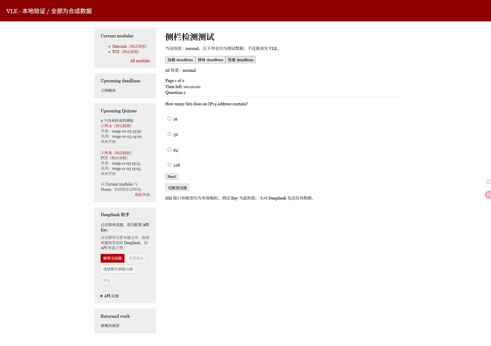

# CDUTOBU VLE Evolved

为 [CDUT OBU VLE](https://vle.zycdut.net/) 提供更清晰的测验侧栏和 DeepSeek 辅助答题体验的 Tampermonkey（油猴）脚本。

[安装 v0.3.1](https://github.com/VellowK/CDUTOBU-VLE-Evolved/releases/download/v0.3.1/CDUTOBU-VLE-Evolved.user.js) · [查看 Release](https://github.com/VellowK/CDUTOBU-VLE-Evolved/releases) · [反馈问题](https://github.com/VellowK/CDUTOBU-VLE-Evolved/issues)

> v0.3.1 为预览版。已通过本地模拟测试，尚未完成真实 API Key、油猴扩展和真实 VLE 的联合验证。

## 功能

- **独立的 Upcoming Quizzes 面板**：直接使用原站的模块、标题、正文及链接样式，保留原分类和 Upcoming deadlines；没有 deadline 时测验面板仍显示。“刷新列表”采用与 All modules 一样的右对齐文字链接。
- **当前课程范围**：扫描 Home、Current modules 及其分页，按链接去重、按开放时间排序，过滤已关闭的测验，不扫描 All modules 或归档课程。
- **DeepSeek 预设**：地址和模型已配好，填写自己的 API Key 即可使用。
- **单题解答**：读取当前题干、选项和图片附件，显示答案建议、简短解释和模型自报置信度。
- **连续填写**：手动开启后逐题求解、选择并进入下一题，跨页面恢复；遇到歧义、低置信度或错误时暂停。
- **保留最终确认**：不会自动开始测验；连续模式在 Finish 前停止，由用户核对并正式提交。



## 安装

1. 在浏览器安装 [Tampermonkey](https://www.tampermonkey.net/)。
2. 点击上方“安装 v0.3.1”，在油猴安装页检查匹配网站和权限并安装。
3. 如果浏览器只下载了 `.user.js` 文件，在油猴中新建脚本，将文件全部内容粘贴后保存。
4. 打开并自行登录 `https://vle.zycdut.net/`，刷新页面。

如果已经安装旧版，请替换或禁用旧脚本，避免同时启用多个副本。v0.3.1 将名称统一为 **CDUTOBU VLE Evolved**；如果油猴将它识别为新条目，请先停用旧的 **VLE Upcoming Quizzes + DeepSeek**，或在原脚本编辑器中全量替换以保留该条目的 Key。脚本中的更新地址指向本仓库 `main` 分支的安装文件，仓库仍保留旧文件路径以兼容已有更新地址。

## 使用 DeepSeek

1. 在侧栏 **DeepSeek 助手 → API 设置** 中填写自己的 [DeepSeek API Key](https://platform.deepseek.com/api_keys)，点击“保存 Key”。
2. 自行打开测验并开始尝试。
3. 点击 **解答当前题** 获取建议，检查后点击 **采用建议** 填入当前题。
4. 或点击 **连续解答到提交前**，逐题填写并翻页。需要中断时点击 **停止**。
5. 最后一题填写后，核对答案并自行点击网站的 **Finish**。

预设为官方 `https://api.deepseek.com/chat/completions` 和 `deepseek-flash`，无需填写接口地址或模型。模型与图片输入格式依据 [DeepSeek 官方文档](https://api-docs.deepseek.com/)、[Vision 文档](https://api-docs.deepseek.com/guides/vision/)，核对日期为 2026-10-23。API 调用使用用户自己的额度并产生费用，本项目不提供 Key。

置信度低于 85%、模型标记需要复核、答案格式异常或页面状态变化时，连续模式会停止。如果模型给出了可供复核的暂定答案，可以勾选“我已核对这道题”后采用；没有确定答案时需自行选择。模型自报置信度不等于正确率保证。

## 支持范围与限制

| 项目 | 当前支持 |
|---|---|
| 网站 | `https://vle.zycdut.net/*` 顶层页面 |
| 页面结构 | 当前已观察到的 Drupal 侧栏和 Quiz 表单 |
| 自动填写题型 | 每页一道、结构可识别的单选题 |
| 题图 | 同源 JPG、PNG、GIF、WebP 内嵌图片和图片附件 |
| 图片限制 | 最多 4 张，单张 4MB；编码后总大小最多 12MB |
| 其他附件和题型 | PDF、SVG、多选、填空等暂停处理 |
| 时间 | 按北京时间 UTC+8 解释原站日期 |
| 列表扫描 | 最多 60 页，每页最多等待 12 秒；失败时提示不完整 |

不支持跨站、带查询参数或未识别格式的图片。站点改版、特殊题干、图片不清晰、模型误判和网络异常都可能影响结果。若整个侧栏被站点隐藏，面板也会随之隐藏。

本项目是独立的个人工具，与学校及 DeepSeek 无隶属或背书关系。使用时请遵守课程规则和站点要求。

## 数据与权限

- API Key 保存到油猴脚本专属存储，不写入 VLE 的 localStorage/sessionStorage；保存后清空输入框，不回显已保存的 Key。
- Key 不是加密保管的秘密保险库；可以在设置里清除，在 DeepSeek 平台撤销。请勿写入源码、Issue 或截图。
- 点击解答或开启连续模式后，才向 DeepSeek 发送本题文字、选项和题图；不发送整页 HTML、学生资料或网站表单隐藏字段。
- 图片先由浏览器同源读取并转成 data URL；不会把网站 Cookie 或图片登录信息交给 DeepSeek。
- API 请求固定发往 `api.deepseek.com`，使用独立 Bearer Key、不附带 Cookie、不跟随重定向；模型输出只作为 JSON 和文本处理，不执行代码。
- 连续模式只记录在当前标签页并限定当前 Quiz。离开本次测验后停止，无后台定时开考或批量启动功能。

| 油猴权限 | 用途 |
|---|---|
| `GM_getValue / GM_setValue / GM_deleteValue` | 保存、读取和清除用户的 DeepSeek Key |
| `GM_xmlhttpRequest` | 调用固定的 DeepSeek API，避免浏览器跨域限制 |
| `GM_getTab / GM_saveTab` | 在当前标签页跨翻页保留连续模式状态 |
| `@connect api.deepseek.com` | 将外部连接域名限定为 DeepSeek |

## 开发

需要 Node.js 20 或更高版本，无需安装第三方依赖。

```sh
npm run build
npm run check
npm test
```

```text
src/
  sidebar.js             # 侧栏挂载与当前测验发现
  deepseek.js            # 固定 Provider、请求与严格响应校验
  quiz-assistant.js      # 题目识别、设置、建议与连续模式
scripts/build.cjs        # 生成单文件油猴脚本
tests/deepseek.test.cjs   # Provider 单元测试
tests/fixtures/          # 仅本地使用的模拟页面和 GM 接口替身
outputs/CDUTOBU-VLE-Evolved.user.js
docs/testing.md          # 验证范围和限制
LICENSE
```

本地模拟界面：

```sh
node tests/fixtures/server.cjs
```

打开 `http://127.0.0.1:8765/node/1/take?case=normal`。测试 Key 可填写 `sk-local-fixture-only-0000`。测试服务提供 GM 接口替身，所有模型响应由本机模拟，不会连接 DeepSeek；为了便于 DOM 断言，测试页使用 open Shadow DOM，交付脚本使用 closed Shadow DOM。其他场景见 [测试说明](docs/testing.md)。

## 反馈

请提供脚本版本、浏览器和油猴版本、复现步骤以及脱敏后的页面结构或截图。不要提交 API Key、登录凭据、Cookie、会话令牌或个人成绩记录。

## License

[MIT License](LICENSE) · Copyright (c) 2026 VellowK。允许使用、修改和分发，须保留版权及许可声明；软件按原样提供，不附带担保。

